  

  

##  Sobre mí

🎓 &nbsp;Estudiante de **Ingeniería en Sistemas** en la Universidad Nacional de Ingeniería (UNI), apasionado por la tecnología y el desarrollo de software. 
💻 &nbsp;Trabajo con **Next.js**, **NestJS** y **Laravel**. 
📱 &nbsp;Desarrollo aplicaciones **Android nativas con Kotlin** y exploro el desarrollo multiplataforma con **Flutter**. 
🚀 &nbsp;Mi objetivo: ampliar continuamente mis conocimientos, fortalecer mis habilidades como ingeniero de software y crear soluciones tecnológicas innovadoras y escalables.

##  Tecnologías y herramientas

<picture>
  <source media="(prefers-color-scheme: dark)" srcset="./assets/stack-dark.svg">
  <source media="(prefers-color-scheme: light)" srcset="./assets/stack-light.svg">
  
</picture>

##  Actividad en GitHub

<a href="https://christophermendoz.github.io/ChristopherMendoz/">
<picture>
  <source media="(prefers-color-scheme: dark)" srcset="https://github-readme-stats.vercel.app/api?username=ChristopherMendoz&show_icons=true&count_private=true&hide=stars%2Cissues&show=reviews%2Cprs_merged&hide_rank=true&locale=es&card_width=467&custom_title=Estad%C3%ADsticas%20en%20GitHub&bg_color=1F1D2B&title_color=73B3B9&text_color=F2E6D6&icon_color=F0AB72&border_color=5C5579&border_radius=12">
  <source media="(prefers-color-scheme: light)" srcset="https://github-readme-stats.vercel.app/api?username=ChristopherMendoz&show_icons=true&count_private=true&hide=stars%2Cissues&show=reviews%2Cprs_merged&hide_rank=true&locale=es&card_width=467&custom_title=Estad%C3%ADsticas%20en%20GitHub&bg_color=F2E6D6&title_color=1E89AB&text_color=5C5579&icon_color=E3566A&border_color=B1C8C2&border_radius=12">
  
</picture>
</a>
<a href="https://christophermendoz.github.io/ChristopherMendoz/">
<picture>
  <source media="(prefers-color-scheme: dark)" srcset="https://github-readme-stats.vercel.app/api/top-langs/?username=ChristopherMendoz&layout=compact&langs_count=7&locale=es&card_width=467&custom_title=Lenguajes%20m%C3%A1s%20usados&bg_color=1F1D2B&title_color=73B3B9&text_color=F2E6D6&border_color=5C5579&border_radius=12">
  <source media="(prefers-color-scheme: light)" srcset="https://github-readme-stats.vercel.app/api/top-langs/?username=ChristopherMendoz&layout=compact&langs_count=7&locale=es&card_width=467&custom_title=Lenguajes%20m%C3%A1s%20usados&bg_color=F2E6D6&title_color=1E89AB&text_color=5C5579&border_color=B1C8C2&border_radius=12">
  
</picture>
</a>

<a href="https://christophermendoz.github.io/ChristopherMendoz/">
<picture>
  <source media="(prefers-color-scheme: dark)" srcset="https://streak-stats.demolab.com/?user=ChristopherMendoz&locale=es&background=1F1D2B&border=5C5579&stroke=5C5579&ring=E3566A&fire=F0AB72&currStreakNum=F2E6D6&sideNums=73B3B9&currStreakLabel=F0AB72&sideLabels=F2E6D6&dates=B1C8C2&border_radius=12">
  <source media="(prefers-color-scheme: light)" srcset="https://streak-stats.demolab.com/?user=ChristopherMendoz&locale=es&background=F2E6D6&border=B1C8C2&stroke=B1C8C2&ring=E3566A&fire=F0AB72&currStreakNum=5C5579&sideNums=1E89AB&currStreakLabel=E3566A&sideLabels=5C5579&dates=5C5579&border_radius=12">
  
</picture>
</a>

  
   Gráficas interactivas: pasa el cursor, filtra por lenguaje y busca repositorios.

<b>📈 Ver mi actividad de los últimos 31 días</b>

 

<picture>
  <source media="(prefers-color-scheme: dark)" srcset="https://github-readme-activity-graph.vercel.app/graph?username=ChristopherMendoz&bg_color=1F1D2B&color=F2E6D6&title_color=73B3B9&line=73B3B9&point=E3566A&area=true&area_color=1E89AB&hide_border=false&radius=12&custom_title=Actividad%20de%20los%20%C3%BAltimos%2031%20d%C3%ADas">
  <source media="(prefers-color-scheme: light)" srcset="https://github-readme-activity-graph.vercel.app/graph?username=ChristopherMendoz&bg_color=F2E6D6&color=5C5579&title_color=1E89AB&line=1E89AB&point=E3566A&area=true&area_color=73B3B9&hide_border=false&radius=12&custom_title=Actividad%20de%20los%20%C3%BAltimos%2031%20d%C3%ADas">
  
</picture>

##  Contribuciones

<picture>
  <source media="(prefers-color-scheme: dark)" srcset="https://raw.githubusercontent.com/ChristopherMendoz/ChristopherMendoz/output/snake-dark.svg">
  <source media="(prefers-color-scheme: light)" srcset="https://raw.githubusercontent.com/ChristopherMendoz/ChristopherMendoz/output/snake-light.svg">
  
</picture>

##  Contacto

  

